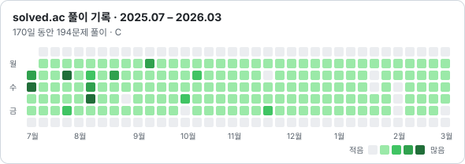

<h3>정상 흐름 너머, 예외까지 구현하는 임베디드 SW 개발자 임나경입니다</h3>

QNX 기반 차량 업데이트 SW를 실무에서 분석하고, 로그로 원인을 코드까지 추적하며, 기존 코드에 없던 예외 처리를 더해 리뷰를 통과시켰습니다.

---

### 💼 Currently

**차량 OTA 개발팀 · 연구원(인턴)** · 2026.05 – 현재

- QNX 환경에서 차량 업데이트 SW 빌드, 시퀀스·클래스 다이어그램으로 코드 분석
- 정상 로그와 실패 로그를 비교해 원인을 출력 코드 위치까지 추적
- 기존 C++ 코드 강건화 (파일 처리 단계별 상태 확인, atomic·mutex 동기화) → 리뷰 통과·반영
- 사내 AI를 활용한 Jira Board 개발·팀 배포 → 한 달 치 워크로그·라벨 수정 반나절에서 10분으로 단축

---

### 🛠️ Tech

**Language**

**OS · Automotive**

**Tool**

---

### 🚗 Projects

| 프로젝트 | 내 역할 | 결과 |
|:---|:---|:---|
| [**MOBIUS-BOOTCAMP-PBL-NoBrake**](https://github.com/MOBIUS-BOOTCAMP-PBL-NoBrake) OTA 기반 차량 기능 업데이트 시스템 · 현대모비스 부트캠프 | CAPL 입력 ECU 4종, 스마트 라이트 제어, 시스템 통합 테스트 | 업데이트·롤백 시나리오 검증 |
| [**Sl0wmon**](https://github.com/Sl0wmon) OBD-II·페달 센서 기반 급발진 감지 · 캡스톤 | 팀장, 라즈베리파이 임베디드 파트 단독 담당 | 학회 논문경진대회 동상 |
| [**mo-meet**](https://github.com/mo-meet) AI 회의록 요약 동아리 관리 앱 · 캡스톤 | 팀장, AI 회의록 서버·백엔드 | 학회 논문경진대회 은상 |
| [**DaliBike**](https://github.com/DaliBike) 공공데이터 기반 자전거 편의 앱 · 창의프로젝트 | 팀장, 지도·위치 데이터·위험 요소 제보 | 경진대회 장려상 · 학회 동상 |

그 외: [Camp-Site](https://github.com/Camp-Site) 캠핑구역 예약 시스템 · [moiggu](https://github.com/moiggu) 관광 기반 모임 앱

---

### 📊 Stats

